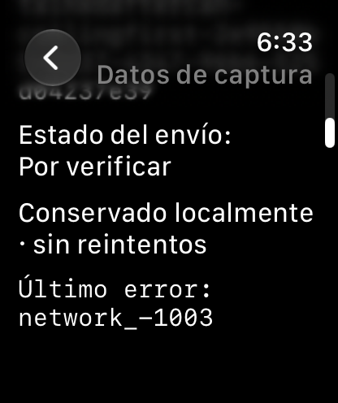
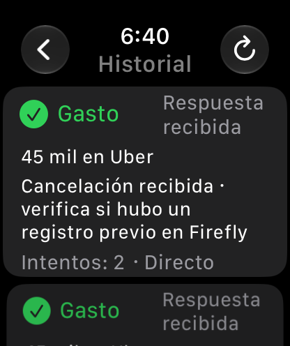

# Complete Watch simulator acceptance — 0.3.6 (11)

Status: the complete signed application candidate is ready for a coordinated in-place installation after a fresh physical preservation preflight. All simulator acceptance and storage checks passed. Neither physical device was updated during this validation.

Jose requested complete simulator validation before another installation invitation, without waiting beside the Mini during builds or testing. The prepared candidate includes the iPhone app and its embedded Watch app. Existing app/module/Keychain identities and the stored outbox format remain unchanged.

## Changes

The stuck Reminder can be retained in History before opening a distinct draft. Its full original payload, timestamp, UUID, attempts and uncertain result stay intact; retention stops local retries and does not cancel a Todoist task or prove one absent. The connection check sends an unsigned, read-only health request.

Watch review also found that an old expense-confirmation response could mask a newer sending attempt after relaunch. The editor now keeps Registrar disabled while any confirmation for that operation is still sending.

A shared, pure presentation helper now keeps the durable prior-registration warning for uncertain expense cancellations across immediate results, relaunch and batch retries on both platforms, and in Watch History. Pending, failed and sending cancellations retain requested/pending wording; only a safe correlated cancellation receipt receives acknowledged wording. The original response and all request/status fields are preserved. Ordinary never-dispatched cancellations keep their normal message. This presentation does not change server authority or make sending rows retryable.

## Verification

App source: `b7bf9156678bcd36a4418a549b48f7a1cd291e26`.

| Check | Result |
|---|---|
| Shared Core suite, including eight new presentation regressions | 95 passed, zero failures |
| Native watchOS UI suite | 26 passed, zero failures/skips; one clean run, 701.274 test seconds |
| Companion iPhone UI suite | 18 passed, zero failures/skips; one clean run, 459.683 test seconds |
| Independent synthetic outbox/request-audit checks | All 26 cases passed |
| Matching build-11 iPhone/Watch pair, plain unconfigured setup check | One additional case passed, zero failures/skips |
| Complete signed parent and embedded Watch build | Passed |
| Independent source, fixture-isolation and signing reviews | Passed |
| GitHub checks on app source | Passed |

The native UI runs use isolated Apple Watch Series 11 (46mm)/iPhone 17 Pro simulators with watchOS/iOS 27.0 and Xcode 27.2. They exercise the real Watch keyboard, native confirmation/cancel controls, scrolling and History navigation. Synthetic requests use an explicit in-memory URLSessioning implementation. No real credentials, Todoist/Firefly writes or paid model calls are used. Simulator support and auditing compile only in Debug simulator builds; physical fixtures are absent from the signed bundle.

Coverage includes the three approved actions, empty/unconfigured screens, normal receipts, six retries of the same grocery request, the four-attempt DNS Reminder, retention/cancel/relaunch/distinct intent, pending and expired reminders, read-only health classifications, exact eligible batch replay, retained-row exclusion, expense confirmation/double tap, ordinary cancellation, durable uncertain cancellation, refreshed-token uncertainty and interruption after a cancellation claim. Audit checks bind POST bodies to their durable payload hashes and require a positive-control log for no-POST assertions. Missing audit files cannot establish zero sends.

The [result summary](WATCH_SIMULATOR_ACCEPTANCE_RESULTS.json) and [26-case storage/audit report](WATCH_SIMULATOR_STORAGE_RESULTS.json) contain no user credentials or physical-device identifiers. Selected native Watch screenshots were visually reviewed; these are synthetic test states, not live task or financial records.

## Signed candidate and installation boundary

Both apps are version 0.3.6, build 11. The private archive retains the existing certificate, Team, app IDs and signed entitlements. Strict/deep signatures, exact hardware coverage and complete copied bundle trees passed independent verification, including generated AppIntents metadata and both debug dylibs. No runtime credentials or user state are packaged. The archive remains private because its provisioning profiles contain device identifiers.

- Complete 30-file production-source seal: `691d6cf66a75592ac9cbfd60bcc667054e240bac3bdd54f4b516f4bedee583cc`.
- Private candidate-manifest SHA256: `445711ff5bce0064bb05a27dcd337e7574c208a13d4346ea55139e9fad40e3db`.
- Development profiles expire November 16 at 13:19:04 Watch / 13:19:07 iPhone, America/Bogota. Recheck validity before installation.

Simulator success does not establish the real Watch developer connection, private-network DNS, Siri routing or notification delivery. The previously inaccessible Watch app-data route remains an installation gate. A future coordinated in-place update requires fresh exact app metadata and selected outbox/preferences backups from both devices first; historical phone backups are not substitutes. No reset, uninstall, queue clear, network/security change, original-capture replay or new assistant-generated live test is part of this work. PR #7 remains open and the whole MVP is not marked physically accepted.

The installation procedure is prepared before asking Jose back. If the bounded Watch preservation preflight still disconnects, stop that attempt and report the connection blocker rather than asking him to keep waiting beside the Mini.

Reproduction commands and the separate host-side verifier are documented in the [Apple app README](../../../apple/PersonalWatchApp/README.md).
